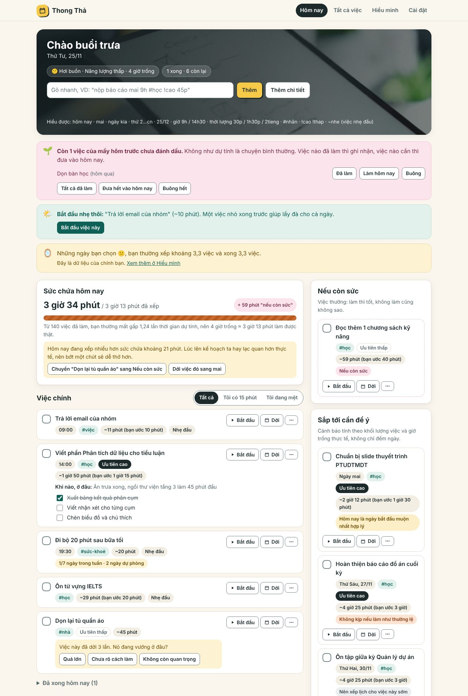
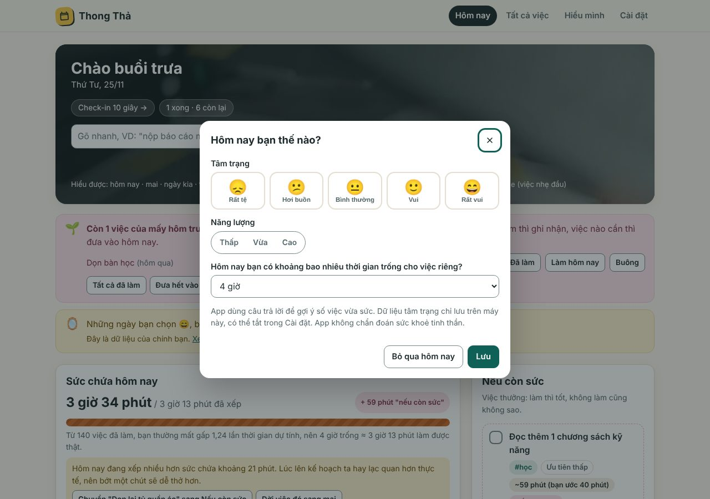
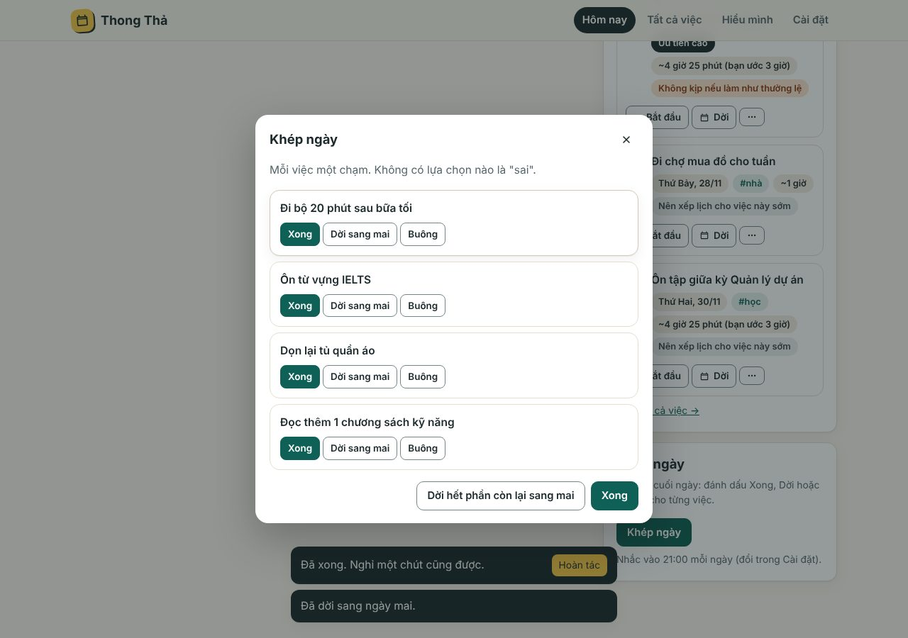
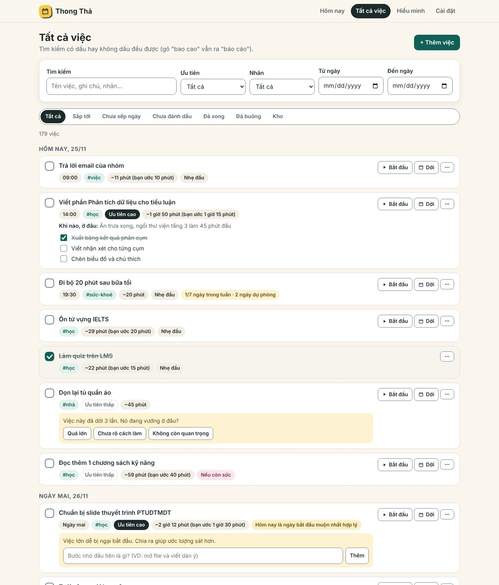
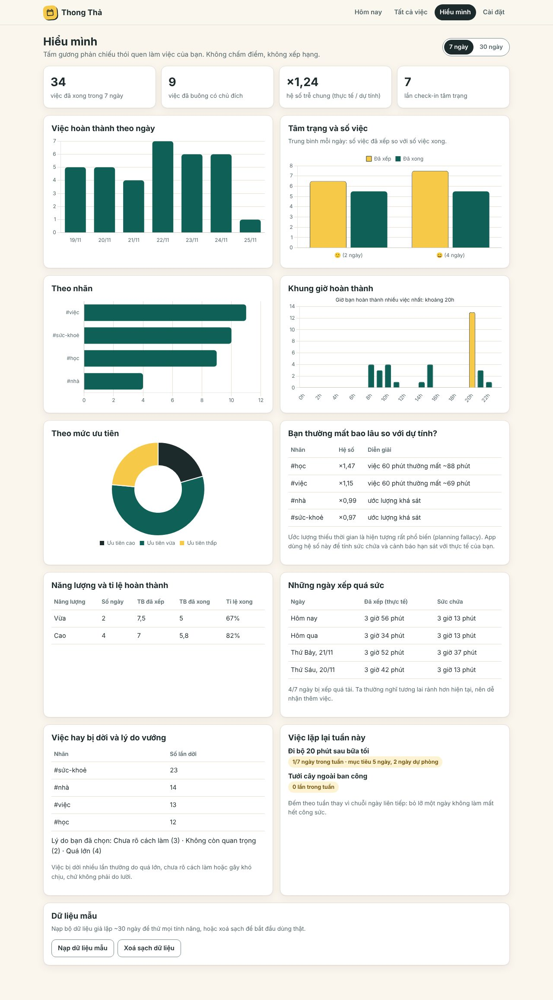
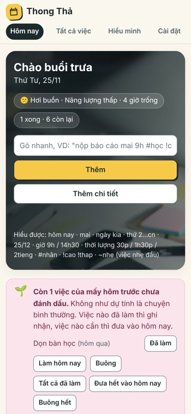

# Thong Thả – quản lý việc cá nhân không áp lực

Ứng dụng web TODO giúp quản lý công việc cá nhân, được thiết kế dựa trên **tâm lý học hành vi**: ước lượng thời gian sát thực tế, không gây cảm giác tội lỗi, ít tốn công cập nhật.



## 1. Vấn đề app giải quyết

Người dùng thường bỏ các app todo vì:

| Vấn đề | Cách Thong Thả xử lý |
|---|---|
| Luôn ước lượng thiếu thời gian → xếp quá tải | Tự đo thời gian thực tế, tính **hệ số trễ cá nhân** và **sức chứa** mỗi ngày |
| Mở app thấy "bức tường" việc quá hạn màu đỏ → né tránh app | Không có chữ "quá hạn", không dùng màu đỏ; việc trễ chuyển thành **"chưa đánh dấu"** |
| Lên lịch xong lười cập nhật trạng thái | **Khép ngày** 30 giây, thao tác hàng loạt, **ghi thời gian tự động** bằng nút Bắt đầu/Dừng |
| Chuỗi ngày (streak) bị đứt → bỏ cuộc | Đếm **x/7 ngày** trong tuần, có **ngày nghỉ dự phòng** |
| Trì hoãn vì cảm xúc (việc khó chịu, tâm trạng thấp) | Check-in tâm trạng, gợi ý **việc khởi động** nhỏ, hỏi **lý do vướng** khi việc bị dời nhiều lần |

## 2. Chức năng

### 2.1. Yêu cầu cơ bản

- **Hiển thị task trong ngày hôm nay** (trang Hôm nay).
- **Tìm kiếm** theo tên, ghi chú, nhãn – có dấu hay không dấu đều tìm được ("bao cao" → "báo cáo").
- **Lọc** theo ưu tiên, nhãn, khoảng ngày, trạng thái (Sắp tới, Chưa xếp ngày, Chưa đánh dấu, Đã xong, Đã buông, Kho).
- **Thêm, sửa, xoá** việc; xoá có nút **Hoàn tác** trong 5 giây thay vì hộp thoại hỏi lại.
- **Trang thống kê** "Hiểu mình" với biểu đồ (Chart.js).
- **Dữ liệu mẫu (mock data)**: tự nạp khi chạy lần đầu; nạp lại hoặc xoá sạch bằng nút trong trang Hiểu mình.

### 2.2. Phần phát triển thêm

| Chức năng | Mô tả |
|---|---|
| Thêm nhanh bằng câu tiếng Việt | Gõ `nộp báo cáo mai 9h #học !cao 45p`, app tự hiểu ngày, giờ, nhãn, ưu tiên, thời lượng và cho xem trước |
| Check-in 10 giây | Mỗi sáng hỏi tâm trạng (5 mức), năng lượng (3 mức), giờ trống; bỏ qua được, tắt được |
| Sức chứa trong ngày | Sức chứa = giờ trống ÷ hệ số trễ cá nhân; thanh "Đã xếp X / Y" và gợi ý bớt việc khi quá tải |
| Hai làn việc | **Việc chính** và **Nếu còn sức** (việc thưởng, không làm không tính thất bại); việc thêm vượt sức chứa được đề xuất vào làn này |
| Cảnh báo hạn theo khối lượng | 3 mức: *Nên xếp lịch sớm* → *Hôm nay là ngày bắt đầu muộn nhất hợp lý* → *Không kịp nếu làm như thường lệ* (kèm gợi ý chia nhỏ/dời) |
| Tấm gương dữ liệu | Ví dụ: "Những ngày bạn chọn 😄, bạn thường xếp 6,9 việc và xong 5,4 việc" – chỉ nêu sự thật, không khuyên răn |
| Việc khởi động | Tâm trạng ≤ 2 hoặc năng lượng thấp → đưa việc nhỏ nhất (≤ 15 phút hoặc "nhẹ đầu") lên đầu |
| Lọc nhanh | "Tôi có 15 phút", "Tôi đang mệt" |
| Bắt đầu / Dừng | Ghi phiên tập trung, tự cộng thời gian thực tế → hệ số trễ tự học |
| Khép ngày | Một màn hình, mỗi việc 3 nút Xong / Dời / Buông; một lời nhắc duy nhất mỗi ngày |
| Chưa đánh dấu | Việc của ngày đã qua chưa xử lý → thẻ gộp "Còn N việc chưa đánh dấu", đánh dấu bù đúng ngày đã làm |
| Hỏi lý do vướng | Việc bị dời ≥ 3 lần: Quá lớn / Chưa rõ cách làm / Không còn quan trọng → chia bước / ghi bước đầu tiên / buông |
| Bước nhỏ đầu tiên | Việc ≥ 60 phút chưa có bước nhỏ → gợi ý ghi bước đầu tiên |
| Kế hoạch "khi nào, ở đâu" | Ô tuỳ chọn cho việc quan trọng |
| Việc lặp lại | Hằng ngày, hằng tuần, hoặc **sau N ngày kể từ lần làm xong**; đếm theo tuần, có ngày dự phòng |
| Bắt đầu lại | Vắng ≥ 3 ngày, hoặc đầu tuần/đầu tháng còn nhiều việc tồn → cất việc cũ vào **Kho**, chọn tối đa 3 việc cho hôm nay |
| Buông có chủ đích | Bỏ việc như một quyết định, thống kê riêng, lấy lại được |
| Trang Hiểu mình | Hệ số trễ theo nhãn, tỉ lệ xong theo tâm trạng/năng lượng, khung giờ hiệu quả, ngày quá tải, việc hay bị dời |

## 3. Cơ sở khoa học của thiết kế

| Hiện tượng tâm lý | Nghiên cứu | Tính năng |
|---|---|---|
| Planning fallacy – ước lượng thiếu thời gian; thiên lệch giảm khi liên hệ với kinh nghiệm cũ | Buehler, Griffin & Ross (1994) | Hệ số trễ cá nhân, hiển thị "~X phút (bạn ước Y)" |
| Biết mình hay trễ không làm dự đoán bớt lạc quan | Friesdorf (luận văn, Wilfrid Laurier) | Hiện **số liệu của chính người dùng** thay vì lời nhắc chung |
| Future time slack – tưởng tương lai rảnh hơn hiện tại | Zauberman & Lynch (2005) | Sức chứa cho mọi ngày, cảnh báo quá tải |
| Unpacking / lập kế hoạch ngược làm ước lượng dài và sát hơn | Kruger & Evans (2004); Wiese và cộng sự (2016) | Gợi ý chia bước, cảnh báo theo "ngày bắt đầu muộn nhất" |
| Implementation intentions – kế hoạch "khi… thì…" (d = 0,65) | Gollwitzer & Sheeran (2006) | Ô "Khi nào, ở đâu tôi sẽ làm" |
| Lập kế hoạch giảm suy nghĩ ám ảnh về việc dang dở | Masicampo & Baumeister (2011) | Khép ngày, Dời có chủ đích |
| Trì hoãn là chuyện điều tiết cảm xúc | Sirois & Pychyl (2013); Steel (2007) | Check-in tâm trạng, việc khởi động, hỏi lý do vướng |
| Tự tha thứ giảm trì hoãn lần sau | Wohl, Pychyl & Bennett (2010) | Không màu đỏ, không phán xét, thông điệp hướng tới bước tiếp theo |
| Streak bị đứt làm giảm tham gia | Silverman & Barasch (2023) | Không streak, đếm x/7 ngày |
| Quỹ dự phòng giúp kiên trì sau thất bại | Sharif & Shu (2021) | Ngày nghỉ dự phòng cho việc lặp |
| Bỏ lỡ một ngày ít ảnh hưởng tới hình thành thói quen | Lally và cộng sự (2010) | Không reset tiến độ khi bỏ lỡ |
| Fresh start effect – mốc thời gian mới tăng động lực | Dai, Milkman & Riis (2014) | Màn hình Bắt đầu lại đầu tuần/đầu tháng |
| Người dùng bỏ dở việc tự theo dõi và cảm thấy tội lỗi | Epstein và cộng sự (2016) | Giảm công ghi nhận, trạng thái "chưa đánh dấu" |

**Lưu ý trung thực:**
- Giả thuyết "tâm trạng tốt dẫn đến xếp quá nhiều việc" **chưa có bằng chứng trực tiếp**. Nghiên cứu gần nhất cho thấy cảm giác có quyền lực làm dự đoán lạc quan hơn. Vì vậy app không áp đặt, mà **kiểm chứng trên dữ liệu của chính người dùng** (Tấm gương dữ liệu).
- Các ngưỡng 0,5 / 0,8 (cảnh báo), 45 phút (việc đủ lớn để cảnh báo), 3 lần dời, 10 lần check-in, 5 mẫu (hệ số trễ), 30 phút (việc chưa ước lượng) là **tham số mặc định do nhóm đặt**, không lấy từ nghiên cứu, có thể điều chỉnh trong `services/planning.js`.
- Dữ liệu mẫu là **dữ liệu giả lập** để demo, không phải kết quả khảo sát.

## 4. Công nghệ

- **Backend:** Node.js + Express
- **Database:** SQLite qua module có sẵn `node:sqlite` (không cần cài thêm, không cần server riêng)
- **Frontend:** HTML, CSS, JavaScript thuần; biểu đồ Chart.js (đóng gói sẵn trong `public/vendor`, chạy được khi không có mạng)
- **Kiểm thử:** `node:test`

Bảng màu đạt chuẩn tương phản **WCAG 2.1 AA**: chữ thường ≥ 4,5:1, phần lớn ≥ 7:1; viền ô nhập ≥ 3:1. Tỉ lệ được ghi chú ngay trong `public/css/style.css`. Giao diện responsive cho điện thoại và tôn trọng chế độ giảm chuyển động.

## 5. Cài đặt và chạy

Yêu cầu: **Node.js 22.13 trở lên** (kiểm tra bằng `node -v`).

```bash
npm install
npm start
```

Mở http://localhost:3000. Lần chạy đầu, app tự nạp dữ liệu mẫu.

| Lệnh | Tác dụng |
|---|---|
| `npm start` | Chạy app |
| `npm test` | Chạy unit test |
| `npm run seed` | Nạp lại dữ liệu mẫu |

Trên Windows, nếu PowerShell báo lỗi *SecurityError / Execution Policies* khi gõ `npm`, hãy dùng `npm.cmd install` và `npm.cmd start`, hoặc mở terminal Command Prompt.

## 6. Cấu trúc thư mục

```
server.js            Khởi động Express, gắn API và trang tĩnh
db/
  schema.sql         Cấu trúc bảng
  db.js              Kết nối SQLite, cài đặt mặc định
  seed.js            Sinh dữ liệu mẫu
routes/
  tasks.js           API công việc
  plan.js            API check-in, kế hoạch hôm nay, thống kê, cài đặt
services/
  planning.js        Hệ số trễ, sức chứa, cảnh báo hạn, tấm gương, việc lặp
  parse.js           Phân tích câu thêm nhanh tiếng Việt
  validate.js        Kiểm tra dữ liệu đầu vào
  dates.js, clock.js Ngày giờ theo múi giờ Việt Nam
  text.js            Bỏ dấu tiếng Việt để tìm kiếm
public/              Giao diện (index, tasks, insights, settings)
tests/               Unit test
docs/                Ảnh chụp màn hình
```

## 7. Cơ sở dữ liệu

| Bảng | Nội dung |
|---|---|
| `tasks` | Việc: tiêu đề, ngày/giờ, ưu tiên, nhãn, loại (nhẹ đầu/cần tập trung), ước tính, thời gian thực tế, trạng thái (`todo`, `done`, `let_go`, `unconfirmed`, `archived`), làn, kế hoạch khi–thì, lý do vướng, số lần dời, kiểu lặp, ngày dự phòng, xoá mềm |
| `subtasks` | Các bước nhỏ của một việc |
| `daily_checkins` | Tâm trạng, năng lượng, giờ trống mỗi ngày |
| `task_events` | Nhật ký hành vi: tạo, bắt đầu, xong, dời, buông, khôi phục… |
| `focus_sessions` | Các phiên Bắt đầu/Dừng → thời gian thực tế |
| `settings` | Sức chứa mặc định, giờ Khép ngày, bật/tắt check-in |

## 8. API

| Phương thức | Đường dẫn | Chức năng |
|---|---|---|
| GET | `/api/tasks?view=today\|upcoming\|nodate\|unconfirmed\|archived&q=&tag=&priority=&status=&from=&to=&fits=` | Danh sách, tìm kiếm, lọc |
| POST / PUT / DELETE | `/api/tasks`, `/api/tasks/:id` | Thêm / sửa / xoá mềm |
| POST | `/api/tasks/:id/restore` | Hoàn tác xoá, lấy lại việc đã buông/trong Kho |
| POST | `/api/tasks/:id/complete` `{done_date?}` | Hoàn thành (cho phép đánh dấu bù) |
| POST | `/api/tasks/:id/postpone` `{to}` | Dời: `today`, `tomorrow`, `weekend` hoặc `YYYY-MM-DD` |
| POST | `/api/tasks/:id/let-go`, `/friction`, `/start`, `/stop` | Buông, lý do vướng, phiên tập trung |
| POST | `/api/tasks/bulk` | Thao tác hàng loạt |
| GET / PUT | `/api/checkins/today` | Check-in tâm trạng |
| GET | `/api/today-plan` | Sức chứa, việc khởi động, tấm gương, Bắt đầu lại, Khép ngày |
| POST | `/api/parse` | Phân tích câu thêm nhanh |
| POST | `/api/fresh-start` | Bắt đầu lại: giữ tối đa 3 việc, cất phần còn lại vào Kho |
| GET | `/api/insights?range=7\|30` | Thống kê Hiểu mình |
| GET / PUT | `/api/settings` | Cài đặt |
| POST | `/api/seed`, `/api/reset` | Nạp dữ liệu mẫu / xoá sạch |

## 9. Ảnh chụp màn hình

| Check-in buổi sáng | Khép ngày |
|---|---|
|  |  |

| Tất cả việc | Hiểu mình |
|---|---|
|  |  |

Giao diện điện thoại: 

## 10. Tài liệu tham khảo

- Buehler, R., Griffin, D., & Ross, M. (1994). Exploring the "planning fallacy". *Journal of Personality and Social Psychology, 67*(3), 366–381.
- Dai, H., Milkman, K. L., & Riis, J. (2014). The fresh start effect. *Management Science, 60*(10), 2563–2582.
- Epstein, D. A., et al. (2016). Beyond abandonment to next steps. *Proceedings of CHI 2016*, 1109–1113.
- Gollwitzer, P. M., & Sheeran, P. (2006). Implementation intentions and goal achievement: A meta-analysis. *Advances in Experimental Social Psychology, 38*, 69–119.
- Kruger, J., & Evans, M. (2004). If you don't want to be late, enumerate. *Journal of Experimental Social Psychology, 40*(5), 586–598.
- Lally, P., et al. (2010). How are habits formed. *European Journal of Social Psychology, 40*(6), 998–1009.
- Masicampo, E. J., & Baumeister, R. F. (2011). Consider it done! *Journal of Personality and Social Psychology, 101*(4), 667–683.
- Sharif, M. A., & Shu, S. B. (2021). Nudging persistence after failure through emergency reserves. *Organizational Behavior and Human Decision Processes, 163*, 17–29.
- Silverman, J., & Barasch, A. (2023). On or off track: How (broken) streaks affect consumer decisions. *Journal of Consumer Research, 49*(6), 1095–1117.
- Sirois, F., & Pychyl, T. (2013). Procrastination and the priority of short-term mood regulation. *Social and Personality Psychology Compass, 7*(2), 115–127.
- Steel, P. (2007). The nature of procrastination. *Psychological Bulletin, 133*(1), 65–94.
- Wiese, J., Buehler, R., & Griffin, D. (2016). Backward planning. *Judgment and Decision Making, 11*(2), 147–167.
- Wohl, M. J. A., Pychyl, T. A., & Bennett, S. H. (2010). I forgive myself, now I can study. *Personality and Individual Differences, 48*(7), 803–808.
- Zauberman, G., & Lynch, J. G. (2005). Resource slack and propensity to discount delayed investments of time versus money. *Journal of Experimental Psychology: General, 134*(1), 23–37.

Video banner: nguồn Pexels (cần ghi tên tác giả theo trang tải về).
